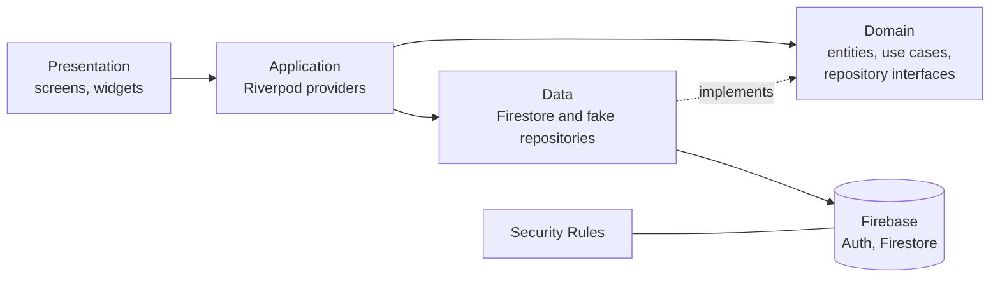

<div align="center">

# GoGoal

**GG – Good Game.** Find a pickup game near you, or post one and fill the missing spots.


</div>

## About

GoGoal is a mobile app for the amateur sports community in Ho Chi Minh City. Anyone short of players can post a game ("kèo") in seconds, and players nearby can browse, filter and request to join.

Supported sports: football, badminton, basketball, pickleball and tennis.

The core problems it tackles:

- **Not enough players.** Hosts publish open slots instead of messaging a dozen group chats.
- **Wrong skill level.** Every game has a level range (beginner to advanced), and join requests outside it are blocked.
- **No-shows.** Attendance and post-game ratings feed a reputation score shown on every profile.
- **Splitting the court fee.** The cost per player is calculated automatically, and approved members get a VietQR code to pay the host.

## Features

The project is built in vertical slices: each feature goes through UX, UI, database, security rules and Flutter before the next one starts.

**Phase 1 – MVP**

- [x] Onboarding and location permission
- [x] Discover screen: games sorted by distance, sport and time filters, search, loading/empty/offline states (mock data)
- [x] Login and register screens (UI only)
- [x] Firestore data model, indexes and seed data for the Discover screen
- [x] Firestore security rules for users, venues, games and join requests
- [ ] Email, Google and Facebook sign-in with Firebase Auth
- [ ] Profile setup (sports, skill levels, bank account for payments)
- [ ] Game details, create game, join and approve requests
- [ ] VietQR payment code for approved members
- [ ] My games and in-app notifications

**Phase 2**

- [ ] Map of nearby games
- [ ] Game chat
- [ ] Attendance, ratings and reputation score
- [ ] Reports and a minimal admin panel

## Tech stack

| Layer | Technology |
|---|---|
| Mobile app | Flutter (Android, iOS), Dart |
| State and dependency injection | Riverpod |
| Navigation | go_router |
| Backend | Firebase Auth, Cloud Firestore (Spark plan, no Cloud Functions) |
| Business rules on the server | Firestore Security Rules, client-side transactions validated with `getAfter()` |
| Location | geolocator, geohash |
| Payments | VietQR (QR image only, no in-app payment) |
| Local development | Firebase Emulator Suite, Node.js seed script |
| Design | Figma, Be Vietnam Pro font |

## Architecture

The app follows Clean Architecture, organised by feature. Business rules such as "can this player join this game?" live in plain Dart entities in the domain layer, so they can be tested without Flutter or Firebase.



Because the Spark plan has no server code, every write that touches several documents (for example joining a game and increasing its player count) runs as a batch or transaction, and the security rules check the state after the write.

## Project structure

```
gogoal/
├── app/                  Flutter app
│   └── lib/
│       ├── core/         theme, router, shared widgets, utilities
│       └── features/     auth, onboarding, discover, match, sport, ...
│           └── <feature>/{domain, data, application, presentation}
├── firebase/
│   ├── firestore.rules
│   ├── firestore.indexes.json
│   ├── firebase.json     emulator configuration
│   └── seed/             sample data for local development
└── docs/                 requirements, use cases, database, architecture, UX/UI specs
```

## Getting started

### Prerequisites

- Flutter 3.47 or newer (Dart 3.13 or newer)
- Android Studio with an emulator, or an Android phone with USB debugging enabled
- Node.js 20 or newer, JDK 21 and the Firebase CLI (only needed for the local backend)

On Windows, turn on **Developer Mode** (Settings → For developers). Flutter needs it to create symlinks for plugins.

### Run the app

```bash
git clone https://github.com/hoangclh0722-netizen/gogoal.git
cd gogoal/app
flutter pub get
flutter run
```

The app currently runs on mock data, so no Firebase project is needed for this step.

### Run the local backend

Start the Firestore emulator:

```bash
cd firebase
firebase emulators:start --only firestore --project demo-gogoal
```

In a second terminal, load the sample data (9 venues, 6 hosts, 20 games around Ho Chi Minh City):

```bash
cd firebase/seed
npm install
npm run seed
```

Open the Emulator UI at http://localhost:4000 to browse the data. The emulator does not keep data between restarts, so run the seed again after each start.

## Documentation

Detailed project documents are in [`docs/`](docs/README.md) (in Vietnamese): decisions, requirements, use cases, database design, architecture, screen list, task plan, and testing and deployment.

## Academic context

GoGoal is developed as the course project for **Software Engineering Project** (Đồ án Công nghệ Phần mềm) at the **University of Transport Ho Chi Minh City (UTH)**, supervised by **Lê Văn Quốc Anh**.

The onboarding illustrations are temporary placeholders and will be replaced with original artwork before any public release.

## Author

Cao Lê Huy Hoàng

## License

Released under the [MIT License](LICENSE).
