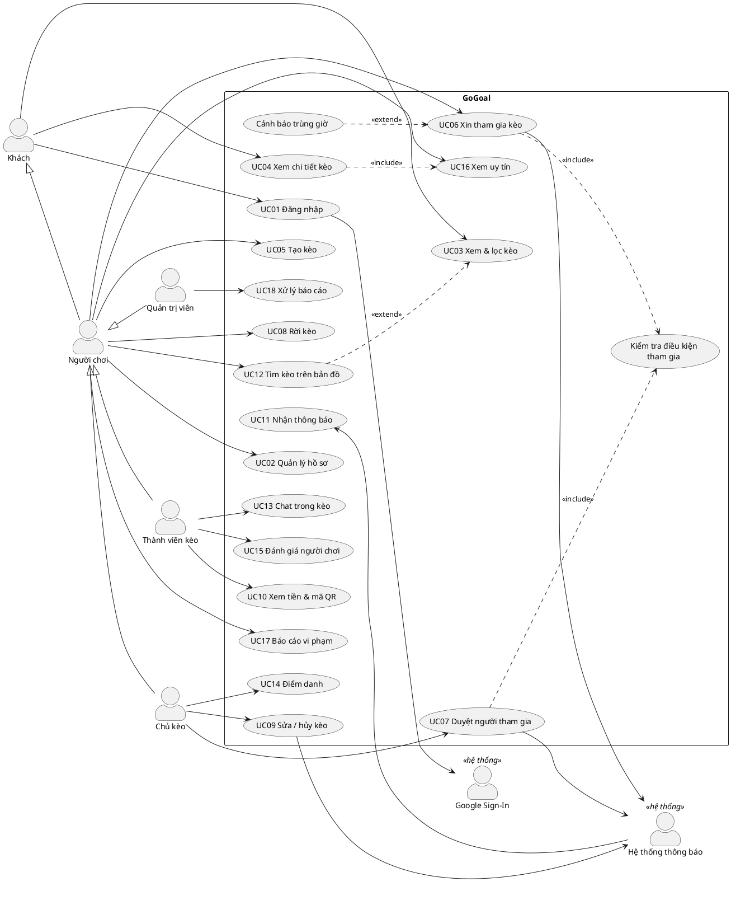
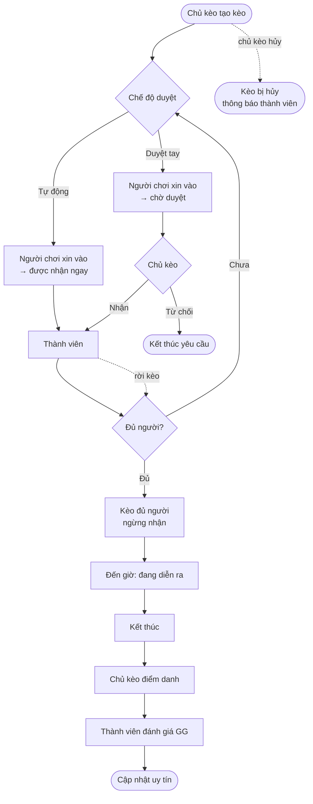

# 3. Use case

## 3.1. Tác nhân

| Tác nhân | Mô tả |
|---|---|
| **Khách** | Chưa đăng nhập; chỉ xem danh sách và chi tiết kèo (không thấy thông tin ngân hàng, chat) |
| **Người chơi** | Đã đăng nhập và hoàn thành hồ sơ |
| **Chủ kèo** | Người chơi đã tạo một kèo; *kế thừa* mọi use case của Người chơi |
| **Thành viên kèo** | Người chơi đã được duyệt vào một kèo; *kế thừa* Người chơi |
| **Quản trị viên** | Người chơi có `role = admin` |
| **Hệ thống thông báo** | Tác nhân phụ: thông báo trong app và local notification trên thiết bị |
| **Google Sign-In** | Tác nhân phụ: nhà cung cấp danh tính |

## 3.2. Sơ đồ use case

Sơ đồ viết bằng PlantUML (chuẩn UML, hỗ trợ `include`/`extend` và kế thừa tác nhân). Xem bằng extension *PlantUML* trong VS Code hoặc dán vào [plantuml.com](https://www.plantuml.com/plantuml) để xuất ảnh PNG/SVG cho báo cáo.

## 3.3. Danh sách use case

| Mã | Tên | Tác nhân chính | Giai đoạn | Mức ưu tiên |
|---|---|---|---|---|
| UC01 | Đăng nhập / đăng ký / đăng xuất | Khách | 1 | Cao |
| UC02 | Quản lý hồ sơ | Người chơi | 1 | Cao |
| UC03 | Xem & lọc kèo, xem "Kèo của tôi" | Khách, Người chơi | 1 | Cao |
| UC04 | Xem chi tiết kèo | Khách, Người chơi | 1 | Cao |
| UC05 | Tạo kèo | Người chơi | 1 | Cao |
| UC06 | Xin tham gia kèo | Người chơi | 1 | Cao |
| UC07 | Duyệt / từ chối / xóa người tham gia | Chủ kèo | 1 | Cao |
| UC08 | Rời kèo / hủy yêu cầu | Người chơi | 1 | Cao |
| UC09 | Sửa / hủy kèo | Chủ kèo | 1 | Trung bình |
| UC10 | Xem tiền mỗi người & mã QR | Thành viên kèo | 1 | Trung bình |
| UC11 | Nhận thông báo | Người chơi | 1 | Trung bình |
| UC12 | Tìm kèo trên bản đồ | Người chơi | 2 | Trung bình |
| UC13 | Chat trong kèo | Thành viên kèo | 2 | Trung bình |
| UC14 | Điểm danh | Chủ kèo | 2 | Trung bình |
| UC15 | Đánh giá người chơi | Thành viên kèo | 2 | Trung bình |
| UC16 | Xem uy tín | Người chơi | 2 | Thấp |
| UC17 | Báo cáo vi phạm | Người chơi | 2 | Thấp |
| UC18 | Xử lý báo cáo | Quản trị viên | 2 | Thấp |

## 3.4. Đặc tả use case

### UC01 – Đăng nhập

| Mục | Nội dung |
|---|---|
| Tác nhân | Khách; phụ: Google Sign-In |
| Mô tả | Khách đăng nhập để dùng các chức năng cần tài khoản |
| Tiền điều kiện | Thiết bị có kết nối mạng |
| Hậu điều kiện | Phiên đăng nhập được lưu; nếu là lần đầu, tài liệu `users/{uid}` được tạo và người dùng được chuyển tới màn hình hoàn thành hồ sơ |
| Luồng chính | 1. Khách chọn "Đăng nhập với Google". 2. Hệ thống mở hộp thoại Google. 3. Khách chọn tài khoản. 4. Hệ thống xác thực với Firebase Auth. 5. Hệ thống kiểm tra hồ sơ: đã đủ → vào Trang chủ; chưa có → UC02 |
| Luồng thay thế | 1a. Khách chọn email: nhập email + mật khẩu → đăng nhập. 1b. Chưa có tài khoản: chọn "Đăng ký", nhập email, mật khẩu (≥ 8 ký tự), xác nhận → tạo tài khoản, gửi email xác minh. 1c. Quên mật khẩu: nhập email → gửi email đặt lại |
| Ngoại lệ | E1. Khách hủy hộp thoại Google → quay lại màn hình đăng nhập. E2. Sai mật khẩu → báo lỗi, không tiết lộ email có tồn tại hay không. E3. Tài khoản bị khóa (`banned = true`) → đăng xuất và hiển thị thông báo khóa |

### UC02 – Quản lý hồ sơ

| Mục | Nội dung |
|---|---|
| Tác nhân | Người chơi |
| Tiền điều kiện | Đã đăng nhập |
| Hậu điều kiện | `users/{uid}` được cập nhật; `profileCompleted = true` khi đủ thông tin bắt buộc |
| Luồng chính | 1. Người chơi mở Hồ sơ → Sửa. 2. Nhập tên hiển thị, quận, giới thiệu. 3. Chọn môn và trình độ cho từng môn. 4. (Tùy chọn) nhập ngân hàng, số tài khoản, tên chủ tài khoản. 5. Lưu. 6. Hệ thống kiểm tra hợp lệ và cập nhật |
| Ngoại lệ | E1. Chưa chọn môn nào → báo "Chọn ít nhất 1 môn". E2. Số tài khoản không phải chữ số hoặc dài quá 19 ký tự → báo lỗi |

### UC03 – Xem & lọc kèo

| Mục | Nội dung |
|---|---|
| Tác nhân | Khách, Người chơi |
| Hậu điều kiện | Hiển thị danh sách kèo sắp diễn ra, chưa hủy |
| Luồng chính | 1. Mở tab Khám phá. 2. Hệ thống tải 20 kèo gần nhất theo thời gian, ưu tiên môn của người chơi. 3. Người chơi chọn bộ lọc: môn, quận, ngày, trình độ, "còn chỗ". 4. Hệ thống tải lại danh sách. 5. Cuộn cuối danh sách → tải thêm 20 kèo |
| Luồng thay thế | 1a. Mở tab "Kèo của tôi": hiển thị kèo đã tạo và đã tham gia, chia "Sắp tới" / "Đã qua" |
| Ngoại lệ | E1. Không có kèo phù hợp → hiển thị trạng thái trống + nút "Tạo kèo". E2. Mất mạng → hiển thị dữ liệu cache, kèm thông báo ngoại tuyến |

### UC04 – Xem chi tiết kèo

| Mục | Nội dung |
|---|---|
| Tác nhân | Khách, Người chơi |
| Luồng chính | 1. Chọn một kèo. 2. Hệ thống hiển thị: môn, thể thức, giờ, địa điểm (bản đồ thu nhỏ), trình độ, tiền mỗi người, số chỗ còn lại, chủ kèo kèm điểm uy tín (include UC16), danh sách thành viên. 3. Hiển thị nút hành động theo vai trò: Khách → "Đăng nhập để tham gia"; Người chơi → "Xin vào"; Thành viên → "Chat", "Thanh toán", "Rời kèo"; Chủ kèo → "Quản lý", "Sửa", "Hủy" |

### UC05 – Tạo kèo

| Mục | Nội dung |
|---|---|
| Tác nhân | Người chơi |
| Tiền điều kiện | Đã đăng nhập, hồ sơ hoàn chỉnh, tài khoản không bị khóa |
| Hậu điều kiện | Tài liệu `matches/{id}` được tạo với `status = active`; người tạo trở thành Chủ kèo |
| Luồng chính | 1. Bấm "+" Tạo kèo. 2. Chọn môn → hệ thống gợi ý các thể thức của môn. 3. Chọn thể thức → hệ thống điền sẵn tổng số người. 4. Nhập số chỗ cần tuyển. 5. Chọn ngày, giờ bắt đầu, giờ kết thúc. 6. Chọn địa điểm: tìm trong danh sách sân hoặc ghim trên bản đồ. 7. Chọn khoảng trình độ. 8. Nhập tổng tiền sân → hệ thống hiển thị tiền mỗi người (BR02). 9. Chọn chế độ duyệt, uy tín tối thiểu, ghi chú. 10. Xem lại và bấm "Đăng kèo". 11. Hệ thống kiểm tra BR01 và lưu kèo. 12. Mở màn hình chi tiết kèo vừa tạo, kèm nút chia sẻ link |
| Luồng thay thế | 10a. Chủ kèo chưa có thông tin ngân hàng và tiền sân > 0 → nhắc bổ sung (có thể bỏ qua) |
| Ngoại lệ | E1. Vi phạm BR01 → báo lỗi tại trường thời gian. E2. Số chỗ cần tuyển ≥ tổng số người → báo lỗi. E3. Lưu thất bại do mạng → giữ nguyên dữ liệu đã nhập, cho thử lại |

### UC06 – Xin tham gia kèo

| Mục | Nội dung |
|---|---|
| Tác nhân | Người chơi; phụ: Hệ thống thông báo |
| Tiền điều kiện | Đã đăng nhập; không phải chủ kèo; chưa có yêu cầu trong kèo này |
| Hậu điều kiện | Có tài liệu `participants/{uid}` với `status = pending` (kèo duyệt tay) hoặc `approved` (kèo tự động, `slotsFilled` tăng 1) |
| Luồng chính | 1. Ở chi tiết kèo, bấm "Xin vào". 2. Hệ thống kiểm tra điều kiện tham gia (include: BR03, BR04). 3. Hệ thống tìm kèo trùng giờ (extend: cảnh báo BR05, người chơi xác nhận tiếp tục). 4. Người chơi nhập lời nhắn (tùy chọn) và xác nhận. 5. Hệ thống tạo yêu cầu `pending`. 6. Gửi thông báo "Có người xin vào" cho chủ kèo. 7. Nút chuyển thành "Đang chờ duyệt" |
| Luồng thay thế | 5a. Kèo ở chế độ tự động: trong cùng một transaction tạo participant `approved` và tăng `slotsFilled`; gửi thông báo "Có người vào kèo" cho chủ kèo; đặt lịch nhắc giờ (UC11) |
| Ngoại lệ | E1. Kèo đã đủ người / đã bắt đầu / đã hủy → báo lỗi, làm mới chi tiết kèo. E2. Trình độ không phù hợp → báo "Kèo yêu cầu trình độ X–Y". E3. Uy tín thấp hơn yêu cầu → báo lỗi. E4. Hai người cùng giành chỗ cuối ở kèo tự động → transaction thất bại cho người đến sau, báo "Kèo vừa đủ người" |

### UC07 – Duyệt người tham gia

| Mục | Nội dung |
|---|---|
| Tác nhân | Chủ kèo; phụ: Hệ thống thông báo |
| Tiền điều kiện | Có yêu cầu `pending`; kèo chưa bắt đầu, chưa hủy |
| Hậu điều kiện | Yêu cầu chuyển `approved` (và `slotsFilled` tăng 1) hoặc `rejected` |
| Luồng chính | 1. Chủ kèo mở "Quản lý kèo" (hoặc bấm thông báo). 2. Hệ thống hiển thị danh sách chờ kèm trình độ, uy tín, lời nhắn. 3. Chủ kèo bấm "Nhận". 4. Hệ thống kiểm tra kèo còn chỗ (include: kiểm tra điều kiện). 5. Transaction: participant → `approved`, `slotsFilled` + 1. 6. Thông báo "Bạn đã được nhận" cho người chơi |
| Luồng thay thế | 3a. Bấm "Từ chối": participant → `rejected`, thông báo cho người chơi. 3b. Xóa thành viên đã nhận: participant → `removed`, `slotsFilled` − 1, thông báo cho người bị xóa |
| Ngoại lệ | E1. Kèo đã đủ → không cho nhận, gợi ý tăng số chỗ (UC09). E2. Người chơi đã tự hủy yêu cầu → làm mới danh sách |

### UC08 – Rời kèo

| Mục | Nội dung |
|---|---|
| Tác nhân | Người chơi |
| Tiền điều kiện | Có yêu cầu `pending` hoặc `approved`; kèo chưa bắt đầu |
| Hậu điều kiện | Participant → `left`; nếu trước đó `approved` thì `slotsFilled` − 1; nếu rời muộn (BR07) thì `lateLeaves` + 1 |
| Luồng chính | 1. Bấm "Rời kèo". 2. Hệ thống hiển thị xác nhận; nếu trong vòng 3 giờ trước giờ đá, cảnh báo bị trừ uy tín. 3. Người chơi xác nhận. 4. Hệ thống cập nhật. 5. Thông báo cho chủ kèo. 6. Hủy lịch nhắc giờ |

### UC09 – Sửa / hủy kèo

| Mục | Nội dung |
|---|---|
| Tác nhân | Chủ kèo |
| Tiền điều kiện | Kèo chưa bắt đầu, chưa hủy |
| Luồng chính (sửa) | 1. Bấm "Sửa". 2. Thay đổi thông tin. 3. Hệ thống kiểm tra BR01, BR12. 4. Lưu. 5. Nếu đổi giờ hoặc địa điểm: thông báo cho mọi thành viên |
| Luồng thay thế (hủy) | 1. Bấm "Hủy kèo", nhập lý do. 2. Hệ thống cảnh báo nếu hủy muộn (BR08). 3. Xác nhận → `status = cancelled`, `cancelReason` được lưu; nếu hủy muộn và có thành viên thì `lateCancels` + 1. 4. Thông báo cho mọi thành viên và người đang chờ |

### UC10 – Xem tiền & mã QR

| Mục | Nội dung |
|---|---|
| Tác nhân | Thành viên kèo |
| Tiền điều kiện | Đã được duyệt; tiền sân > 0; chủ kèo có thông tin ngân hàng |
| Luồng chính | 1. Bấm "Thanh toán". 2. Hệ thống hiển thị số tiền mỗi người và mã VietQR (ngân hàng, số tài khoản, số tiền, nội dung `GG <mã kèo> <tên>`). 3. Thành viên quét bằng app ngân hàng và chuyển khoản bên ngoài. 4. Bấm "Tôi đã chuyển" → `paid = true` |
| Luồng thay thế | 2a. Chủ kèo chưa nhập ngân hàng → hiển thị "Liên hệ chủ kèo để thanh toán". 4a. Chủ kèo xác nhận đã nhận tiền trong màn quản lý → `paidConfirmed = true` |

### UC11 – Nhận thông báo

| Mục | Nội dung |
|---|---|
| Tác nhân | Hệ thống thông báo |
| Luồng chính | 1. Một hành động (UC06, UC07, UC08, UC09) tạo tài liệu `users/{uid}/notifications/{id}` cho người nhận. 2. App của người nhận (đang mở) lắng nghe collection này, hiện banner và tăng số trên biểu tượng chuông. 3. Người chơi bấm thông báo → mở màn hình liên quan, đánh dấu đã đọc |
| Luồng thay thế | 1a. Khi người chơi được duyệt vào kèo: app đặt local notification nhắc trước giờ bắt đầu 2 giờ; khi rời kèo hoặc kèo bị hủy thì hủy lịch |
| Giới hạn | Không có thông báo đẩy khi app đã đóng (gói Spark). Khi mở lại app, người chơi thấy các thông báo chưa đọc |

### UC12 – Tìm kèo trên bản đồ

| Mục | Nội dung |
|---|---|
| Tác nhân | Người chơi |
| Luồng chính | 1. Bấm biểu tượng bản đồ ở tab Khám phá (extend UC03). 2. Hệ thống xin quyền vị trí. 3. Lấy vị trí hiện tại, truy vấn kèo trong bán kính mặc định 5 km (geohash). 4. Hiển thị marker theo màu môn. 5. Bấm marker → thẻ tóm tắt → bấm tiếp → UC04. 6. Kéo thanh bán kính 1–20 km → truy vấn lại |
| Ngoại lệ | E1. Từ chối quyền vị trí → dùng tâm TP.HCM, cho phép kéo bản đồ và bấm "Tìm ở khu vực này" |

### UC13 – Chat trong kèo

| Mục | Nội dung |
|---|---|
| Tác nhân | Thành viên kèo (gồm Chủ kèo) |
| Tiền điều kiện | Có participant `approved` hoặc là chủ kèo; tài khoản không bị khóa |
| Luồng chính | 1. Bấm "Chat". 2. Hệ thống tải 50 tin gần nhất và lắng nghe tin mới. 3. Nhập tin (≤ 1000 ký tự) và gửi. 4. Tin xuất hiện với mọi thành viên đang mở chat |
| Ghi chú | Chat chỉ mở đến 24 giờ sau giờ kết thúc; sau đó chỉ đọc |

### UC14 – Điểm danh

| Mục | Nội dung |
|---|---|
| Tác nhân | Chủ kèo |
| Tiền điều kiện | Đã qua giờ kết thúc, chưa quá 24 giờ (BR09) |
| Hậu điều kiện | Mỗi participant `approved` có `attended = true/false`; người vắng có `noShows` + 1, người có mặt có `matchesPlayed` + 1 |
| Luồng chính | 1. App nhắc chủ kèo "Điểm danh trận vừa rồi". 2. Hệ thống hiển thị danh sách thành viên, mặc định "Có mặt". 3. Chủ kèo đánh dấu người vắng. 4. Xác nhận → batch ghi cập nhật |
| Luồng thay thế | 1a. Hết 24 giờ mà chưa điểm danh → mọi người được tính có mặt khi có người mở kèo lần tiếp theo |

### UC15 – Đánh giá người chơi

| Mục | Nội dung |
|---|---|
| Tác nhân | Thành viên kèo có mặt |
| Tiền điều kiện | Trong 48 giờ sau giờ kết thúc (BR10) |
| Hậu điều kiện | Tài liệu `ratings/{matchId}_{from}_{to}` được tạo; `ratingSum`, `ratingCount` của người được chấm tăng |
| Luồng chính | 1. Bấm "GG! Đánh giá đồng đội". 2. Hệ thống hiển thị các thành viên có mặt khác. 3. Với mỗi người, chọn 1–5 sao và thẻ (Đúng giờ, Fair-play, Vui vẻ, Chơi hay). 4. Gửi → batch ghi rating và cập nhật thống kê người được chấm |
| Ngoại lệ | E1. Đã đánh giá người này → ẩn người đó khỏi danh sách |

### UC16 – Xem uy tín

| Mục | Nội dung |
|---|---|
| Tác nhân | Người chơi |
| Luồng chính | 1. Bấm vào ảnh đại diện của một người chơi. 2. Hệ thống hiển thị hồ sơ công khai: điểm uy tín (BR11), số trận, số lần vắng, các thẻ được nhận nhiều nhất, môn và trình độ |

### UC17 – Báo cáo vi phạm

| Mục | Nội dung |
|---|---|
| Tác nhân | Người chơi |
| Luồng chính | 1. Ở hồ sơ người chơi hoặc chi tiết kèo, chọn "Báo cáo". 2. Chọn lý do (bùng kèo, lừa đảo tiền, quấy rối, nội dung không phù hợp, khác) và mô tả. 3. Gửi → tạo `reports/{id}` với `status = open` |
| Ngoại lệ | E1. Đã báo cáo đối tượng này trong kèo này (BR14) → báo "Bạn đã báo cáo" |

### UC18 – Xử lý báo cáo

| Mục | Nội dung |
|---|---|
| Tác nhân | Quản trị viên |
| Tiền điều kiện | `role = admin` |
| Luồng chính | 1. Mở mục "Quản trị" trong Hồ sơ. 2. Xem danh sách báo cáo `open`. 3. Mở báo cáo, xem hồ sơ và lịch sử người bị báo cáo. 4. Chọn: "Khóa tài khoản" (`banned = true`), "Ẩn kèo" (`status = hidden`) hoặc "Bỏ qua". 5. Báo cáo chuyển `resolved` / `dismissed` |

## 3.5. Sơ đồ hoạt động: vòng đời một kèo

