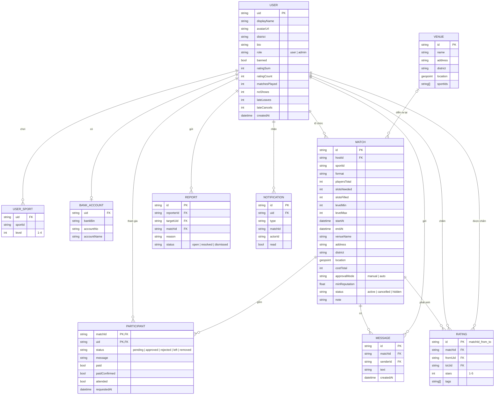
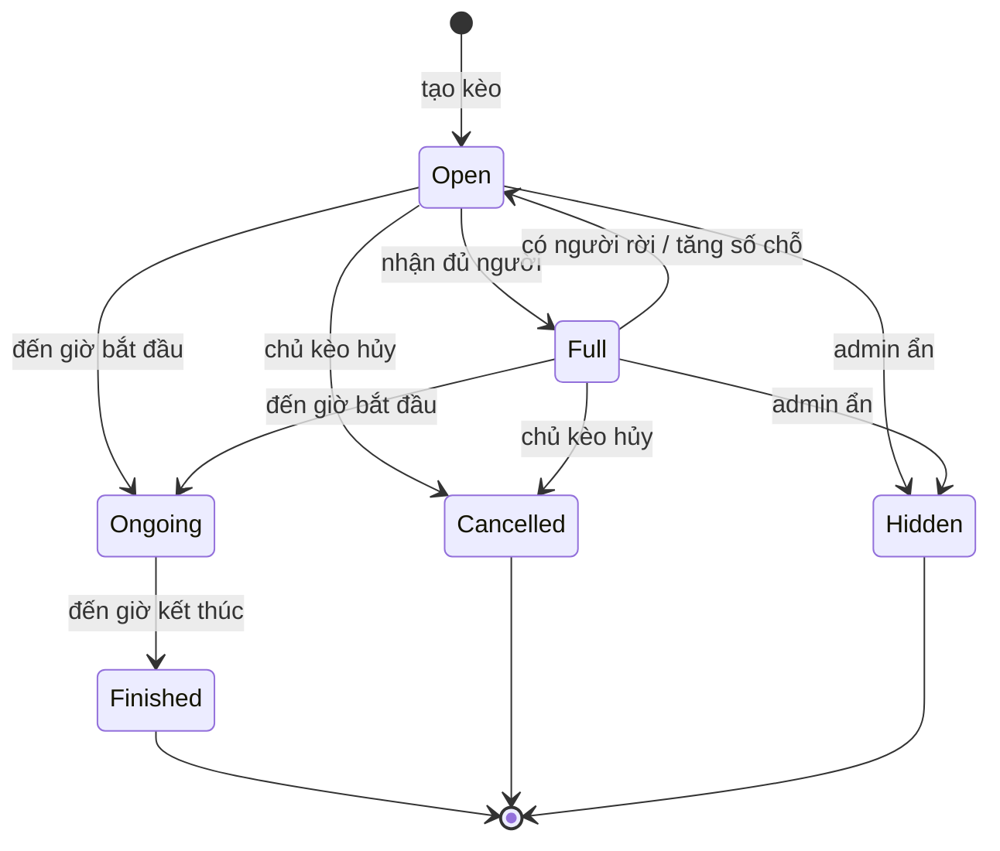
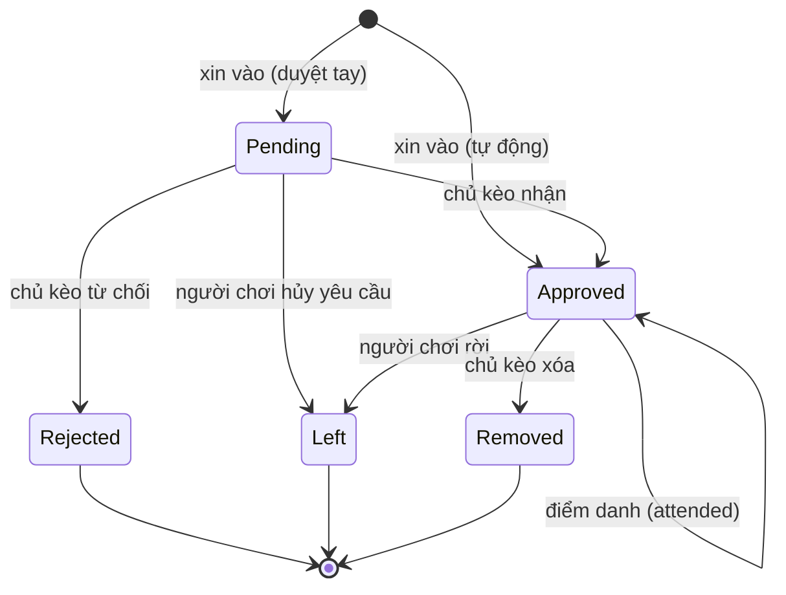

# 4. Thiết kế cơ sở dữ liệu

GoGoal dùng **Cloud Firestore**, một CSDL NoSQL dạng tài liệu (document). Tài liệu này trình bày hai lớp:

1. **Mô hình khái niệm (ERD)**: các thực thể và quan hệ, độc lập với công nghệ.
2. **Mô hình vật lý trên Firestore**: cách ánh xạ ERD sang collection, document, subcollection, cùng các quyết định phi chuẩn hóa (denormalize), chỉ mục và Security Rules.

## 4.1. Mô hình khái niệm (ERD)



**Ràng buộc chính**
- `PARTICIPANT` là bảng liên kết nhiều–nhiều giữa `USER` và `MATCH`, khóa chính kép `(matchId, uid)`, nên một người chỉ có một yêu cầu cho một kèo (BR04).
- `RATING` có khóa `matchId_fromUid_toUid`, nên mỗi người chỉ chấm một người khác một lần trong một kèo (BR10).
- `slotsFilled ≤ slotsNeeded < playersTotal`; `levelMin ≤ levelMax`; `startAt < endAt`.

## 4.2. Ánh xạ sang Firestore

```
users/{uid}                              ← hồ sơ công khai + thống kê
  └── private/profile                    ← dữ liệu riêng tư (ngân hàng)
  └── notifications/{notificationId}     ← thông báo trong app
matches/{matchId}                        ← kèo (kèm bản sao thông tin chủ kèo)
  └── private/payment                    ← bản sao thông tin ngân hàng của chủ kèo
  └── participants/{uid}                 ← người tham gia (id = uid)
  └── messages/{messageId}               ← chat
ratings/{matchId_fromUid_toUid}          ← đánh giá
reports/{reportId}                       ← báo cáo vi phạm
venues/{venueId}                         ← danh sách sân (admin nhập sẵn)
```

### Quy ước
- Thời gian lưu kiểu `Timestamp`; tiền lưu số nguyên đơn vị **đồng**.
- Trình độ: `1 = Mới chơi`, `2 = Trung bình`, `3 = Khá`, `4 = Giỏi`.
- `sportId`: `football`, `badminton`, `basketball`, `pickleball`, `tennis`.
- Mọi document có `createdAt`, document có thể sửa có thêm `updatedAt` (dùng `FieldValue.serverTimestamp()`).

### `users/{uid}`

| Trường | Kiểu | Mô tả |
|---|---|---|
| displayName | string | 2–40 ký tự |
| avatarUrl | string? | Ảnh từ Google hoặc null (dùng avatar chữ cái) |
| district | string | Mã quận, vd `q1`, `binh-thanh`, `thu-duc` |
| bio | string? | ≤ 200 ký tự |
| sports | map<string, int> | `{ "football": 2, "badminton": 1 }` |
| role | string | `user` / `admin` (chỉ admin sửa được) |
| banned | bool | Chỉ admin sửa được |
| profileCompleted | bool | |
| stats | map | `ratingSum, ratingCount, matchesPlayed, noShows, lateLeaves, lateCancels` |
| tagCounts | map<string, int> | Số lần nhận mỗi thẻ đánh giá |
| createdAt, updatedAt | timestamp | |

> Không lưu email trong tài liệu công khai; email nằm ở Firebase Auth.

### `users/{uid}/private/profile`

| Trường | Kiểu | Mô tả |
|---|---|---|
| bankBin | string | Mã BIN ngân hàng theo chuẩn VietQR, vd `970436` (Vietcombank) |
| accountNo | string | Chỉ chữ số, ≤ 19 ký tự |
| accountName | string | Viết hoa không dấu |

Chỉ chính chủ đọc/ghi được.

### `users/{uid}/notifications/{id}`

| Trường | Kiểu | Mô tả |
|---|---|---|
| type | string | `join_requested`, `join_approved`, `join_rejected`, `member_joined`, `member_left`, `match_updated`, `match_cancelled`, `removed`, `rate_reminder` |
| matchId | string | |
| actorId | string | Người gây ra sự kiện |
| actorName | string | Bản sao để hiển thị nhanh |
| matchTitle | string | Bản sao, vd "Bóng đá 5v5 · 19:00 T4" |
| read | bool | |
| createdAt | timestamp | |

### `matches/{matchId}`

| Trường | Kiểu | Mô tả |
|---|---|---|
| hostId | string | |
| host | map | Bản sao `{ displayName, avatarUrl }` để danh sách không phải đọc thêm `users` |
| sportId, format | string | vd `football`, `5v5` |
| playersTotal | int | Tổng người chơi của trận |
| slotsNeeded | int | Số chỗ tuyển qua app |
| slotsFilled | int | Số người đã được nhận |
| isFull | bool | `slotsFilled >= slotsNeeded`, cập nhật cùng transaction, dùng để lọc "còn chỗ" |
| levelMin, levelMax | int | 1–4 |
| levels | int[] | Mảng các mức trong khoảng, vd `[2, 3]`, dùng cho truy vấn `array-contains` |
| startAt, endAt | timestamp | |
| venue | map | `{ venueId?, name, address, district }` |
| geo | map | `{ geohash, geopoint }` theo định dạng của geoflutterfire_plus |
| district | string | Bản sao `venue.district` để lọc |
| costTotal | int | Đồng; 0 = miễn phí |
| costPerPerson | int | Tính theo BR02 khi lưu |
| approvalMode | string | `manual` / `auto` |
| minReputation | number? | |
| note | string? | ≤ 500 ký tự |
| status | string | `active` / `cancelled` / `hidden` |
| cancelReason | string? | |
| attendanceTakenAt | timestamp? | Thời điểm chủ kèo điểm danh |
| createdAt, updatedAt | timestamp | |

### `matches/{matchId}/private/payment`

Bản sao `bankBin, accountNo, accountName` của chủ kèo, tạo cùng lúc với kèo. Chỉ chủ kèo và thành viên `approved` đọc được (NFR05). Tách riêng vì Security Rules không thể ẩn từng trường của một document.

### `matches/{matchId}/participants/{uid}`

| Trường | Kiểu | Mô tả |
|---|---|---|
| uid | string | Trùng id document; cần cho truy vấn collection group |
| matchId | string | |
| matchStartAt | timestamp | Bản sao, để sắp xếp "Kèo của tôi" |
| displayName, avatarUrl | string | Bản sao |
| level | int | Trình độ của người chơi ở môn này lúc xin vào |
| status | string | `pending` / `approved` / `rejected` / `left` / `removed` |
| message | string? | Lời nhắn khi xin vào |
| paid | bool | Người chơi tự đánh dấu đã chuyển |
| paidConfirmed | bool | Chủ kèo xác nhận |
| attended | bool? | null = chưa điểm danh |
| requestedAt, updatedAt | timestamp | |

### `matches/{matchId}/messages/{id}`

`senderId, senderName, text (≤ 1000), createdAt`

### `ratings/{matchId}_{fromUid}_{toUid}`

`matchId, fromUid, toUid, stars (1–5), tags (string[] ⊂ {on_time, fair_play, friendly, skilled}), createdAt`

### `reports/{id}`

`reporterId, targetUid?, matchId?, reason, description, status (open/resolved/dismissed), resolvedBy?, createdAt`

### `venues/{id}`

`name, address, district, geo { geohash, geopoint }, sportIds[]` – admin nhập sẵn khoảng 50 sân phổ biến ở TP.HCM.

## 4.3. Trạng thái tính toán (derived state)

Gói Spark không có server chạy theo lịch, nên **không lưu** các trạng thái phụ thuộc thời gian như "đang diễn ra" hay "đã kết thúc". Firestore chỉ lưu `status` (`active` / `cancelled` / `hidden`). Trạng thái hiển thị được lớp `Match` tính ra:

```
cancelled  nếu status == cancelled
hidden     nếu status == hidden
finished   nếu now ≥ endAt
ongoing    nếu startAt ≤ now < endAt
full       nếu slotsFilled ≥ slotsNeeded
open       còn lại
```



Trạng thái người tham gia:



## 4.4. Truy vấn chính và chỉ mục

| Màn hình | Truy vấn | Chỉ mục composite |
|---|---|---|
| Khám phá (mặc định) | `matches` where `status == active`, `startAt > now`, orderBy `startAt`, limit 20 | `status ASC, startAt ASC` |
| Lọc theo môn | + where `sportId == X` | `status, sportId, startAt` |
| Lọc theo quận | + where `district == X` | `status, district, startAt` |
| Lọc môn + quận | + cả hai | `status, sportId, district, startAt` |
| Lọc trình độ | + where `levels array-contains L` | `status, levels, startAt` (và tổ hợp với môn) |
| Còn chỗ | + where `isFull == false` | thêm `isFull` vào các chỉ mục trên |
| Bản đồ | geoflutterfire_plus `subscribeWithin` trên `geo`, kèm where `status == active` | `status, geo.geohash` |
| Kèo của tôi (tham gia) | collectionGroup `participants` where `uid == me`, `status in [pending, approved]`, orderBy `matchStartAt` | `uid, status, matchStartAt` (collection group) |
| Kèo của tôi (tổ chức) | `matches` where `hostId == me`, orderBy `startAt desc` | `hostId, startAt DESC` |
| Thông báo | `users/{me}/notifications` orderBy `createdAt desc`, limit 30 | đơn |
| Chat | `matches/{id}/messages` orderBy `createdAt desc`, limit 50 | đơn |
| Admin | `reports` where `status == open`, orderBy `createdAt` | `status, createdAt` |

Firestore không hỗ trợ tốt nhiều điều kiện so sánh khoảng trên các trường khác nhau, nên trình độ được lưu thành mảng `levels` để dùng `array-contains`. Đây là kỹ thuật phi chuẩn hóa phổ biến.

Các chỉ mục được khai báo trong `firebase/firestore.indexes.json`.

## 4.5. Ghi dữ liệu nhất quán khi không có server

Mọi thao tác thay đổi nhiều document dùng **transaction** hoặc **batch write**, và Security Rules dùng `getAfter()` để kiểm tra trạng thái *sau khi* ghi, nhằm đảm bảo hai bên luôn khớp nhau.

| Thao tác | Các document ghi cùng lúc |
|---|---|
| Tạo kèo | `matches/{id}` + `matches/{id}/private/payment` |
| Xin vào (tự động) | `participants/{me}` (approved) + `matches/{id}` (`slotsFilled + 1`, `isFull`) + notification cho chủ kèo |
| Xin vào (duyệt tay) | `participants/{me}` (pending) + notification cho chủ kèo |
| Duyệt | `participants/{uid}` (approved) + `matches/{id}` (`slotsFilled + 1`, `isFull`) + notification |
| Rời kèo | `participants/{me}` (left) + `matches/{id}` (`slotsFilled − 1`) + (`users/{me}.stats.lateLeaves + 1` nếu rời muộn) + notification |
| Hủy kèo | `matches/{id}` (cancelled) + (`users/{host}.stats.lateCancels + 1`) + notification cho từng thành viên |
| Điểm danh | `participants/*` (`attended`) + `users/*` (`matchesPlayed` hoặc `noShows` + 1) + `matches/{id}.attendanceTakenAt` |
| Đánh giá | `ratings/{m_from_to}` + `users/{to}` (`ratingSum + stars`, `ratingCount + 1`, `tagCounts`) |

## 4.6. Security Rules (trích đoạn)

Toàn bộ rules nằm ở `firebase/firestore.rules` và có unit test chạy trên Emulator. Một số quy tắc tiêu biểu:

```js
rules_version = '2';
service cloud.firestore {
  match /databases/{db}/documents {

    function signedIn() { return request.auth != null; }
    function me() { return request.auth.uid; }
    function userDoc(uid) { return get(/databases/$(db)/documents/users/$(uid)).data; }
    function notBanned() { return signedIn() && userDoc(me()).banned != true; }
    function isAdmin() { return signedIn() && userDoc(me()).role == 'admin'; }
    function changedOnly(keys) {
      return request.resource.data.diff(resource.data).affectedKeys().hasOnly(keys);
    }

    match /matches/{matchId} {
      // Rules không phải bộ lọc: truy vấn phải tự có where status == 'active' (hoặc hostId == me)
      allow read: if resource.data.status != 'hidden'
        || (signedIn() && resource.data.hostId == me()) || isAdmin();
      allow create: if notBanned()
        && request.resource.data.hostId == me()
        && request.resource.data.slotsFilled == 0
        && request.resource.data.startAt > request.time + duration.value(30, 'm');

      // Chủ kèo sửa thông tin (không được sửa slotsFilled trực tiếp)
      allow update: if notBanned() && resource.data.hostId == me()
        && request.resource.data.slotsFilled == resource.data.slotsFilled
        && request.resource.data.slotsNeeded >= resource.data.slotsFilled;

      // Người chơi tự vào kèo auto: chỉ tăng slotsFilled đúng 1
      // và phải có participant approved của chính mình trong cùng batch
      allow update: if notBanned()
        && resource.data.approvalMode == 'auto'
        && changedOnly(['slotsFilled', 'isFull', 'updatedAt'])
        && request.resource.data.slotsFilled == resource.data.slotsFilled + 1
        && request.resource.data.slotsFilled <= resource.data.slotsNeeded
        && getAfter(/databases/$(db)/documents/matches/$(matchId)/participants/$(me())).data.status == 'approved'
        && !exists(/databases/$(db)/documents/matches/$(matchId)/participants/$(me()));

      match /private/payment {
        allow read: if signedIn() && (
          get(/databases/$(db)/documents/matches/$(matchId)).data.hostId == me()
          || get(/databases/$(db)/documents/matches/$(matchId)/participants/$(me())).data.status == 'approved');
        allow write: if get(/databases/$(db)/documents/matches/$(matchId)).data.hostId == me();
      }
    }

    match /ratings/{ratingId} {
      allow read: if signedIn();
      allow create: if notBanned()
        && request.resource.data.fromUid == me()
        && ratingId == request.resource.data.matchId + '_' + me() + '_' + request.resource.data.toUid
        && request.resource.data.stars >= 1 && request.resource.data.stars <= 5
        && get(/databases/$(db)/documents/matches/$(request.resource.data.matchId)/participants/$(me())).data.attended == true;
      allow update, delete: if false;
    }
  }
}
```

> Đoạn trên là bản phác thảo để minh họa ý tưởng; bản đầy đủ sẽ được viết và kiểm thử trong task tương ứng ở [07-ke-hoach-task.md](07-ke-hoach-task.md).

## 4.7. Ước tính hạn mức gói Spark

Hạn mức miễn phí mỗi ngày: **50.000 lượt đọc, 20.000 lượt ghi, 20.000 lượt xóa**, dung lượng 1 GiB.

| Giả định: 200 người dùng hoạt động / ngày | Đọc | Ghi |
|---|---|---|
| Mở Khám phá 5 lần × 20 kèo | 20.000 | – |
| Xem 5 chi tiết kèo (kèo + ~10 participants) | 11.000 | – |
| Thông báo, kèo của tôi | 6.000 | – |
| Tạo kèo, xin vào, duyệt, chat (~15 thao tác / người) | 3.000 | 3.000 |
| **Tổng** | **≈ 40.000** | **≈ 3.000** |

Đủ cho giai đoạn thử nghiệm. Cache offline của Firestore và phân trang giúp giảm lượt đọc. Khi vượt khoảng 250 người dùng hoạt động mỗi ngày thì cần cân nhắc chuyển sang gói Blaze.
