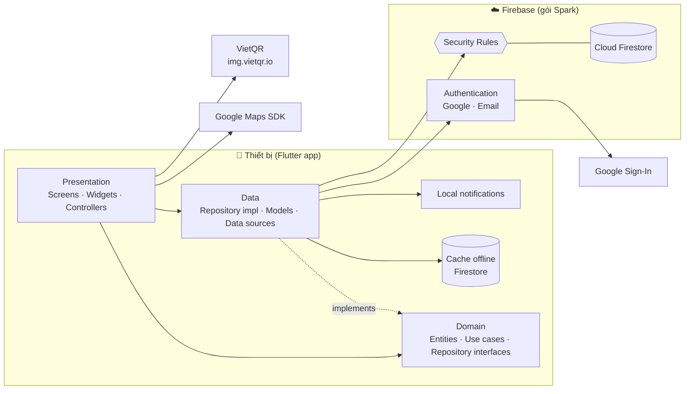
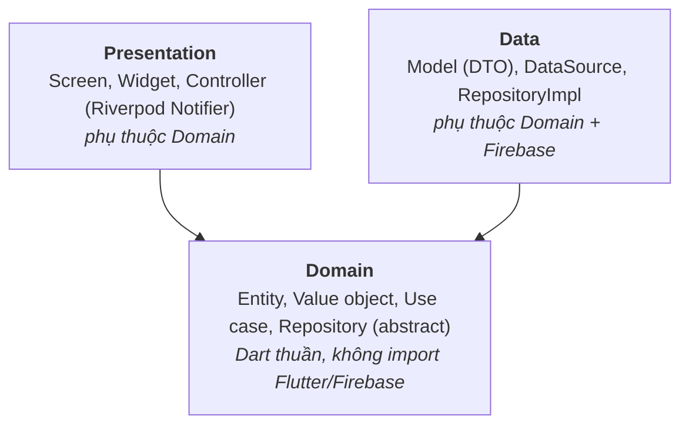
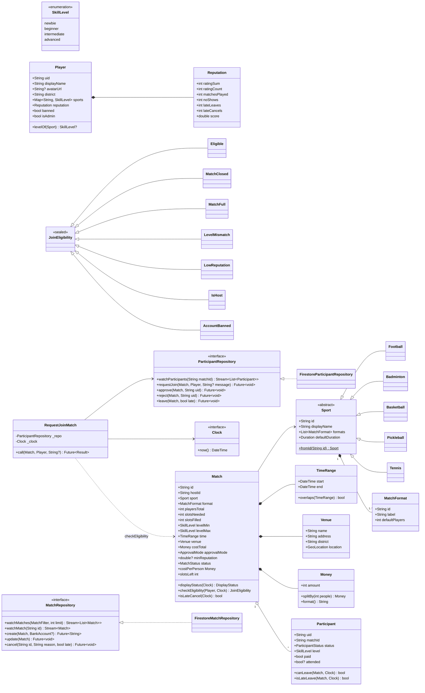
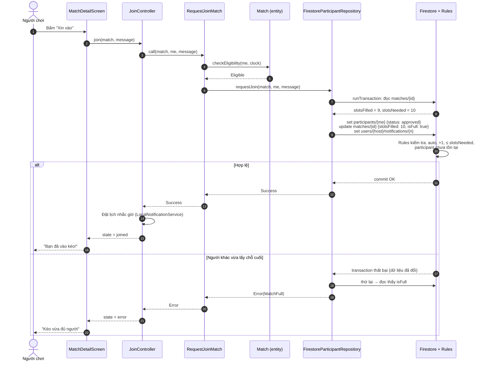
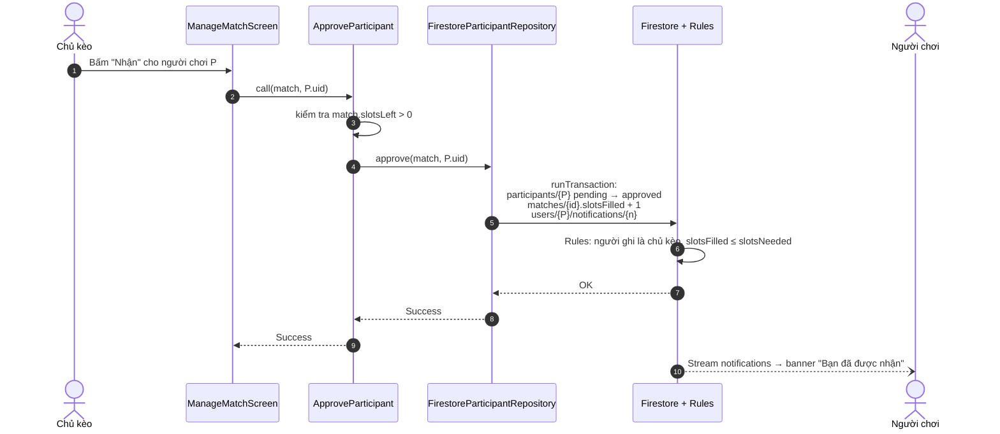

# 5. Kiến trúc hệ thống

## 5.1. Kiến trúc tổng thể



**Đặc điểm chính**
- **Không có server riêng.** App giao tiếp trực tiếp với Firebase. Mọi quy tắc nghiệp vụ được kiểm tra hai lần: ở tầng domain của app (để báo lỗi thân thiện) và ở Security Rules (để chống gian lận).
- **Firestore là nguồn dữ liệu duy nhất** (single source of truth). UI lắng nghe Stream, nên dữ liệu thay đổi thì giao diện tự cập nhật.
- **Môi trường phát triển** dùng Firebase Emulator Suite (Auth + Firestore) chạy trên máy, không tốn hạn mức và không ảnh hưởng dữ liệu thật.

## 5.2. Clean Architecture



| Tầng | Trách nhiệm | Được phép import |
|---|---|---|
| **Domain** | Quy tắc nghiệp vụ, không phụ thuộc framework | Chỉ Dart thuần (+ `equatable`, `meta`) |
| **Data** | Đọc/ghi Firebase, chuyển đổi Model ↔ Entity, bắt lỗi Firebase thành `Failure` | Domain, Firebase SDK |
| **Presentation** | Hiển thị, nhận thao tác, gọi use case, quản lý state màn hình | Domain, Flutter, Riverpod |

**Quy tắc phụ thuộc:** mũi tên chỉ hướng vào Domain. Domain không biết Firebase tồn tại, nên có thể viết unit test cho Domain mà không cần emulator, và có thể đổi backend (vd Supabase) chỉ bằng cách viết lại tầng Data.

## 5.3. Cấu trúc thư mục

```
app/lib/
├── main.dart                     # Khởi tạo Firebase, ProviderScope, chọn emulator khi debug
├── app.dart                      # MaterialApp.router, theme
├── core/
│   ├── clock/clock.dart          # abstract Clock + SystemClock (để test logic thời gian)
│   ├── error/failure.dart        # sealed class Failure
│   ├── result/result.dart        # sealed class Result<T> = Success | Error
│   ├── router/app_router.dart    # go_router, guard đăng nhập / hồ sơ
│   ├── theme/                    # màu, typography, AppTheme sáng/tối
│   ├── utils/                    # format tiền, ngày giờ, validators
│   └── widgets/                  # nút, avatar, empty state dùng chung
├── features/
│   ├── auth/
│   │   ├── domain/   entities/app_user.dart · repositories/auth_repository.dart · usecases/
│   │   ├── data/     firebase_auth_repository.dart
│   │   └── presentation/  login_screen.dart · register_screen.dart · auth_controller.dart
│   ├── profile/      (Player, Reputation, UserRepository, màn hình hồ sơ)
│   ├── sport/        (Sport + các lớp con, MatchFormat, SkillLevel) – chỉ có domain
│   ├── match/        (Match, Participant, MatchRepository, use case tạo/xin vào/duyệt/rời/hủy)
│   ├── discover/     (danh sách, bộ lọc, bản đồ)
│   ├── payment/      (VietQrService, màn hình thanh toán)
│   ├── chat/
│   ├── rating/       (điểm danh, đánh giá)
│   ├── notification/ (NotificationRepository, LocalNotificationService)
│   └── admin/        (báo cáo, khóa tài khoản)
└── l10n/                         # chuỗi tiếng Việt

app/test/                         # cấu trúc giống lib/, unit test domain + widget test
firebase/
├── firebase.json                 # cấu hình emulator
├── firestore.rules
├── firestore.indexes.json
└── rules-test/                   # test Security Rules bằng @firebase/rules-unit-testing
```

## 5.4. Áp dụng OOP

### Bốn tính chất

| Tính chất | Áp dụng | Ví dụ |
|---|---|---|
| **Đóng gói** | Entity giữ dữ liệu `final`, chỉ lộ ra hành vi; quy tắc nghiệp vụ nằm trong entity | `Match.checkEligibility(player, clock)`, `Match.costPerPerson`, `Reputation.score` |
| **Trừu tượng** | Tầng trên chỉ biết interface, không biết cách cài đặt | `abstract interface class MatchRepository`, `Clock`, `LocalNotificationService` |
| **Kế thừa** | Các môn thể thao kế thừa lớp `Sport` | `Football extends Sport`, `Badminton extends Sport` |
| **Đa hình** | Cùng một lời gọi, mỗi lớp xử lý khác nhau | `sport.formats`, `sport.defaultDuration`, `sport.icon`; `switch` trên `sealed class JoinEligibility` |

### Nguyên lý SOLID

| Nguyên lý | Áp dụng |
|---|---|
| **S** – Đơn trách nhiệm | Mỗi use case là một lớp làm một việc: `RequestJoinMatch`, `ApproveParticipant`… |
| **O** – Mở/đóng | Thêm môn mới = thêm lớp con `Sport`, không sửa code cũ (NFR09) |
| **L** – Thay thế Liskov | Mọi chỗ dùng `Sport` đều chạy đúng với bất kỳ lớp con nào; `FakeMatchRepository` thay được `FirestoreMatchRepository` trong test |
| **I** – Tách interface | Tách `MatchRepository` (đọc/ghi kèo) và `ParticipantRepository` (yêu cầu tham gia) thay vì một interface lớn |
| **D** – Đảo phụ thuộc | Use case nhận repository qua constructor; Riverpod cung cấp cài đặt cụ thể |

### Design pattern

| Pattern | Vị trí | Mục đích |
|---|---|---|
| **Repository** | `*Repository` / `Firestore*Repository` | Tách nguồn dữ liệu khỏi logic nghiệp vụ |
| **Strategy** | Các lớp con `Sport` | Mỗi môn có thể thức, số người, thời lượng riêng |
| **Factory** | `Sport.fromId()`, `MatchModel.fromFirestore()` | Tạo đối tượng đúng loại từ dữ liệu thô |
| **Observer** | `Stream<Match>` từ Firestore + Riverpod `StreamProvider` | UI tự cập nhật khi dữ liệu đổi |
| **Dependency Injection** | Riverpod `Provider` | Thay cài đặt thật bằng fake khi test |
| **Value Object** | `Money`, `SkillLevel`, `GeoLocation`, `TimeRange` | Đóng gói kiểm tra hợp lệ, so sánh theo giá trị |
| **DTO / Mapper** | `MatchModel` ↔ `Match` | Tách cấu trúc lưu trữ khỏi entity |

## 5.5. Sơ đồ lớp (tầng Domain)



> Trong báo cáo có thể tách sơ đồ trên thành 3 hình nhỏ: *Sport & thể thức*, *Match & Participant*, *Repository & Use case*.

## 5.6. Code mẫu cho các lớp cốt lõi

```dart
// features/sport/domain/sport.dart
sealed class Sport {
  const Sport();

  String get id;
  String get displayName;
  List<MatchFormat> get formats;
  Duration get defaultDuration => const Duration(hours: 1, minutes: 30);

  static const all = <Sport>[
    Football(), Badminton(), Basketball(), Pickleball(), Tennis(),
  ];

  factory Sport.fromId(String id) => all.firstWhere(
        (s) => s.id == id,
        orElse: () => throw ArgumentError.value(id, 'id', 'Unknown sport'),
      );
}

final class Football extends Sport {
  const Football();
  @override String get id => 'football';
  @override String get displayName => 'Bóng đá';
  @override List<MatchFormat> get formats => const [
        MatchFormat(id: '5v5', label: 'Sân 5', defaultPlayers: 10),
        MatchFormat(id: '7v7', label: 'Sân 7', defaultPlayers: 14),
        MatchFormat(id: '11v11', label: 'Sân 11', defaultPlayers: 22),
      ];
}

final class Badminton extends Sport {
  const Badminton();
  @override String get id => 'badminton';
  @override String get displayName => 'Cầu lông';
  @override Duration get defaultDuration => const Duration(hours: 2);
  @override List<MatchFormat> get formats => const [
        MatchFormat(id: 'singles', label: 'Đánh đơn', defaultPlayers: 2),
        MatchFormat(id: 'doubles', label: 'Đánh đôi', defaultPlayers: 4),
        MatchFormat(id: 'group', label: 'Xoay vòng', defaultPlayers: 8),
      ];
}
```

```dart
// features/match/domain/join_eligibility.dart
sealed class JoinEligibility { const JoinEligibility(); }
final class Eligible extends JoinEligibility { const Eligible(); }
final class IsHost extends JoinEligibility { const IsHost(); }
final class AccountBanned extends JoinEligibility { const AccountBanned(); }
final class MatchClosed extends JoinEligibility { const MatchClosed(); }
final class MatchFull extends JoinEligibility { const MatchFull(); }
final class LevelMismatch extends JoinEligibility {
  const LevelMismatch(this.min, this.max);
  final SkillLevel min, max;
}
final class LowReputation extends JoinEligibility {
  const LowReputation(this.required);
  final double required;
}
```

```dart
// features/match/domain/match.dart
class Match {
  const Match({ /* ... các trường final ... */ });

  // ...các trường final...

  int get slotsLeft => slotsNeeded - slotsFilled;
  Money get costPerPerson => costTotal.splitBy(playersTotal);

  DisplayStatus displayStatus(Clock clock) {
    final now = clock.now();
    return switch (status) {
      MatchStatus.cancelled => DisplayStatus.cancelled,
      MatchStatus.hidden => DisplayStatus.hidden,
      _ when !now.isBefore(time.end) => DisplayStatus.finished,
      _ when !now.isBefore(time.start) => DisplayStatus.ongoing,
      _ when slotsLeft <= 0 => DisplayStatus.full,
      _ => DisplayStatus.open,
    };
  }

  JoinEligibility checkEligibility(Player player, Clock clock) {
    if (player.uid == hostId) return const IsHost();
    if (player.banned) return const AccountBanned();
    final s = displayStatus(clock);
    if (s == DisplayStatus.full) return const MatchFull();
    if (s != DisplayStatus.open) return const MatchClosed();
    final level = player.levelOf(sport);
    if (level == null || level < levelMin || level > levelMax) {
      return LevelMismatch(levelMin, levelMax);
    }
    final min = minReputation;
    if (min != null && player.reputation.score < min) return LowReputation(min);
    return const Eligible();
  }
}
```

```dart
// features/match/domain/usecases/request_join_match.dart
class RequestJoinMatch {
  RequestJoinMatch(this._repo, this._clock);

  final ParticipantRepository _repo;
  final Clock _clock;

  Future<Result<void>> call(Match match, Player me, {String? message}) async {
    final eligibility = match.checkEligibility(me, _clock);
    if (eligibility is! Eligible) {
      return Result.error(JoinFailure(eligibility));
    }
    return _repo.requestJoin(match, me, message: message);
  }
}
```

```dart
// features/profile/domain/reputation.dart
class Reputation {
  const Reputation({this.ratingSum = 0, this.ratingCount = 0, this.matchesPlayed = 0,
      this.noShows = 0, this.lateLeaves = 0, this.lateCancels = 0});

  static const _priorCount = 5;
  static const _priorMean = 4.0;

  final int ratingSum, ratingCount, matchesPlayed, noShows, lateLeaves, lateCancels;

  /// BR11 – trung bình Bayes trừ điểm phạt, giới hạn trong [1, 5].
  double get score {
    final base = (ratingSum + _priorCount * _priorMean) / (ratingCount + _priorCount);
    final penalty = 0.3 * noShows + 0.1 * lateLeaves + 0.2 * lateCancels;
    return (base - penalty).clamp(1.0, 5.0);
  }
}
```

## 5.7. Sơ đồ tuần tự

### UC06 – Xin tham gia kèo tự động duyệt



### UC07 – Chủ kèo duyệt người tham gia



## 5.8. Xử lý lỗi

```dart
sealed class Failure {
  const Failure(this.message);
  final String message;
}
final class NetworkFailure extends Failure { const NetworkFailure() : super('Không có kết nối mạng'); }
final class PermissionFailure extends Failure { const PermissionFailure() : super('Bạn không có quyền thực hiện thao tác này'); }
final class JoinFailure extends Failure { /* bọc JoinEligibility, tạo message tương ứng */ }
final class UnexpectedFailure extends Failure { /* ... */ }
```

- Tầng Data bắt `FirebaseException`, chuyển thành `Failure` (vd `permission-denied` → `PermissionFailure`).
- Use case trả về `Result<T>`; Controller chuyển thành `AsyncValue` để UI hiển thị loading, lỗi, dữ liệu.
- Lỗi không mong đợi được ghi log (giai đoạn sau có thể thêm Crashlytics).

## 5.9. Thư viện sử dụng

| Mục đích | Package |
|---|---|
| Firebase | `firebase_core`, `firebase_auth`, `cloud_firestore` |
| Đăng nhập Google | `google_sign_in` |
| State + DI | `flutter_riverpod`, `riverpod_annotation`, `riverpod_generator` |
| Điều hướng | `go_router` |
| So sánh giá trị | `equatable` |
| Bản đồ & vị trí | `google_maps_flutter`, `geolocator`, `geoflutterfire_plus` |
| Thông báo cục bộ | `flutter_local_notifications`, `timezone` |
| Định dạng | `intl` |
| Ảnh mạng | `cached_network_image` |
| Chia sẻ link | `share_plus` |
| Kiểm thử | `flutter_test`, `mocktail`, `fake_cloud_firestore` |
| Lint | `flutter_lints` (hoặc `very_good_analysis`) |
| Icon app | `flutter_launcher_icons` |

## 5.10. Môi trường

| Môi trường | Backend | Dùng khi |
|---|---|---|
| **dev** | Firebase Emulator Suite trên máy | Phát triển hằng ngày, chạy test Security Rules |
| **prod** | Project Firebase `gogoal-prod` (Spark) | Bản demo đồ án, bản thử nghiệm với người dùng thật |

`main.dart` chọn môi trường qua `--dart-define=ENV=dev|prod`. Khi `dev`, app gọi `useAuthEmulator` và `useFirestoreEmulator` (Android emulator truy cập máy tính qua `10.0.2.2`).

> **Docker:** không dùng trong MVP vì không có server riêng. Nếu sau này cần (vd chạy Emulator trong CI), có thể đóng gói Firebase CLI vào một image Node.
