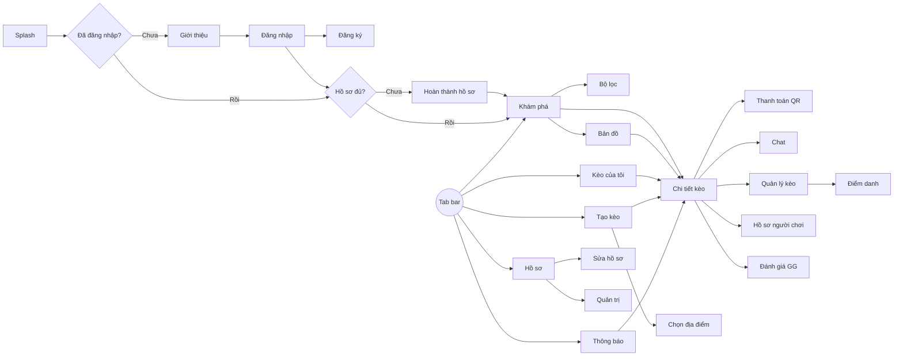

# 6. Màn hình & thiết kế giao diện

## 6.1. Hệ thống thiết kế (design tokens)

| Nhóm | Token | Giá trị |
|---|---|---|
| Màu thương hiệu | `primary` | `#22C55E` (xanh lá) |
| | `primary-dark` | `#16A34A` |
| | `accent` | `#F97316` (cam) |
| | `ink` | `#0F172A` (chữ chính, nền tối) |
| Màu trung tính | `surface` / `background` | `#FFFFFF` / `#F8FAFC` |
| | `muted` / `border` | `#64748B` / `#E2E8F0` |
| Trạng thái | `success` / `warning` / `danger` | `#22C55E` / `#F59E0B` / `#EF4444` |
| Màu theo môn | bóng đá / cầu lông / bóng rổ / pickleball / tennis | `#22C55E` / `#3B82F6` / `#F97316` / `#A855F7` / `#EAB308` |
| Font | Be Vietnam Pro | Hỗ trợ đầy đủ tiếng Việt. Tiêu đề 24/20/17 SemiBold, nội dung 15 Regular, chú thích 13 |
| Bo góc | `radius-sm/md/lg` | 8 / 12 / 20 |
| Khoảng cách | lưới 4pt | 4, 8, 12, 16, 24, 32 |
| Khung | Mobile | 390 × 844 (iPhone 14), lề 16 |

**Thanh điều hướng dưới (5 mục):** Khám phá · Kèo của tôi · **(+) Tạo kèo** (nút nổi màu cam ở giữa) · Thông báo · Hồ sơ

## 6.2. Danh sách màn hình

| Mã | Màn hình | Use case | Giai đoạn |
|---|---|---|---|
| S01 | Splash | – | 1 |
| S02 | Giới thiệu (2 trang) | – | 1 |
| S03 | Đăng nhập | UC01 | 1 |
| S04 | Đăng ký / Quên mật khẩu | UC01 | 1 |
| S05 | Hoàn thành hồ sơ (3 bước) | UC02 | 1 |
| S06 | Khám phá – danh sách kèo | UC03 | 1 |
| S07 | Bộ lọc (bottom sheet) | UC03 | 1 |
| S08 | Chi tiết kèo | UC04, UC06 | 1 |
| S09 | Tạo kèo (3 bước) | UC05 | 1 |
| S10 | Chọn địa điểm | UC05 | 1 |
| S11 | Quản lý kèo (chờ duyệt / thành viên) | UC07, UC09 | 1 |
| S12 | Thanh toán – mã QR | UC10 | 1 |
| S13 | Kèo của tôi | UC03 | 1 |
| S14 | Thông báo | UC11 | 1 |
| S15 | Hồ sơ của tôi | UC02, UC16 | 1 |
| S16 | Sửa hồ sơ & ngân hàng | UC02 | 1 |
| S17 | Bản đồ kèo gần tôi | UC12 | 2 |
| S18 | Chat kèo | UC13 | 2 |
| S19 | Điểm danh | UC14 | 2 |
| S20 | Đánh giá "GG" | UC15 | 2 |
| S21 | Hồ sơ công khai người chơi | UC16, UC17 | 2 |
| S22 | Báo cáo vi phạm (bottom sheet) | UC17 | 2 |
| S23 | Quản trị – danh sách báo cáo | UC18 | 2 |

## 6.3. Luồng màn hình

## 6.4. Thiết kế chi tiết

- Bản thiết kế: [Figma – GoGoal](https://www.figma.com/design/VWNTYmdK4H0Br5EjhFqdUJ).
- Đặc tả UX từng nhóm màn (luồng, trạng thái, nội dung chữ): thư mục [ux/](ux/).
- Quy tắc hình thức từng nhóm màn: thư mục [ui/](ui/).
