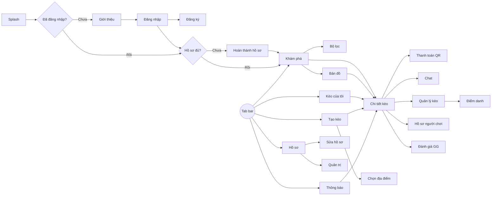

# 6. Màn hình & prompt thiết kế Figma

## 6.1. Hệ thống thiết kế (design tokens)

| Nhóm | Token | Giá trị |
|---|---|---|
| Màu thương hiệu | `primary` | `#22C55E` (xanh lá) |
| | `primary-dark` | `#16A34A` |
| | `accent` | `#F97316` (cam) |
| | `ink` | `#0F172A` (chữ chính, nền tối) |
| Màu trung tính | `surface` / `background` | `#FFFFFF` / `#F8FAFC` |
| | `muted` / `border` | `#64748B` / `#E2E8F0` |
| Trạng thái | `success` / `warning` / `danger` | `#22C55E` / `#F59E0B` / `#EF4444` |
| Màu theo môn | bóng đá / cầu lông / bóng rổ / pickleball / tennis | `#22C55E` / `#3B82F6` / `#F97316` / `#A855F7` / `#EAB308` |
| Font | Be Vietnam Pro | Hỗ trợ đầy đủ tiếng Việt. Tiêu đề 24/20/17 SemiBold, nội dung 15 Regular, chú thích 13 |
| Bo góc | `radius-sm/md/lg` | 8 / 12 / 20 |
| Khoảng cách | lưới 4pt | 4, 8, 12, 16, 24, 32 |
| Khung | Mobile | 390 × 844 (iPhone 14), lề 16 |

**Thanh điều hướng dưới (5 mục):** Khám phá · Kèo của tôi · **(+) Tạo kèo** (nút nổi màu cam ở giữa) · Thông báo · Hồ sơ

## 6.2. Danh sách màn hình

| Mã | Màn hình | Use case | Giai đoạn |
|---|---|---|---|
| S01 | Splash | – | 1 |
| S02 | Giới thiệu (3 trang) | – | 1 |
| S03 | Đăng nhập | UC01 | 1 |
| S04 | Đăng ký / Quên mật khẩu | UC01 | 1 |
| S05 | Hoàn thành hồ sơ (3 bước) | UC02 | 1 |
| S06 | Khám phá – danh sách kèo | UC03 | 1 |
| S07 | Bộ lọc (bottom sheet) | UC03 | 1 |
| S08 | Chi tiết kèo | UC04, UC06 | 1 |
| S09 | Tạo kèo (3 bước) | UC05 | 1 |
| S10 | Chọn địa điểm | UC05 | 1 |
| S11 | Quản lý kèo (chờ duyệt / thành viên) | UC07, UC09 | 1 |
| S12 | Thanh toán – mã QR | UC10 | 1 |
| S13 | Kèo của tôi | UC03 | 1 |
| S14 | Thông báo | UC11 | 1 |
| S15 | Hồ sơ của tôi | UC02, UC16 | 1 |
| S16 | Sửa hồ sơ & ngân hàng | UC02 | 1 |
| S17 | Bản đồ kèo gần tôi | UC12 | 2 |
| S18 | Chat kèo | UC13 | 2 |
| S19 | Điểm danh | UC14 | 2 |
| S20 | Đánh giá "GG" | UC15 | 2 |
| S21 | Hồ sơ công khai người chơi | UC16, UC17 | 2 |
| S22 | Báo cáo vi phạm (bottom sheet) | UC17 | 2 |
| S23 | Quản trị – danh sách báo cáo | UC18 | 2 |

## 6.3. Luồng màn hình



## 6.4. Cách dùng prompt

1. Dán **prompt chung** (6.5) trước, để công cụ AI (Figma Make, First Draft, hoặc các công cụ khác như v0, Galileo/Stitch) nắm phong cách.
2. Sau đó dán **prompt từng màn hình** (6.6), mỗi lần 1–2 màn để kết quả chi tiết hơn.
3. Prompt viết bằng tiếng Anh để AI hiểu tốt hơn, nhưng **chữ hiển thị trên giao diện để nguyên tiếng Việt** trong dấu ngoặc kép.
4. Sau khi tạo xong, chỉnh lại cho đúng token ở 6.1 và gom các phần lặp lại thành component: `MatchCard`, `SportChip`, `LevelBadge`, `ReputationBadge`, `AvatarStack`, `PrimaryButton`, `BottomNav`.

## 6.5. Prompt chung (design system)

```
Design a mobile app UI for "GoGoal" (nickname "GG – Good Game"), a Vietnamese
sports community app for finding and organizing pickup games ("kèo") of football,
badminton, basketball, pickleball and tennis in Ho Chi Minh City.

Style: modern, energetic, friendly, clean. Lots of white space, rounded cards
(12px radius), soft shadows, bold headings. iOS-like but platform-neutral.
Frame: 390x844. Font: "Be Vietnam Pro" (all UI text is Vietnamese with diacritics).
Colors: primary green #22C55E, accent orange #F97316, ink #0F172A, background #F8FAFC,
muted text #64748B, borders #E2E8F0. Each sport has a color tag:
football #22C55E, badminton #3B82F6, basketball #F97316, pickleball #A855F7, tennis #EAB308.
Bottom navigation with 5 items: "Khám phá", "Kèo của tôi", a floating orange
"+" create button in the center, "Thông báo", "Hồ sơ".
Use simple line icons (Lucide style). Avatars are circles; show reputation as
a small star badge like "★ 4.6". Support a dark mode variant with background #0F172A.
```

## 6.6. Prompt từng màn hình

### S01–S02 · Splash & Giới thiệu
```
Splash screen: solid green #22C55E background, centered white "GoGoal" wordmark
with a small football replacing the first "o", tagline "GOOD GAME" below.

Onboarding, 3 swipeable pages with a large friendly illustration of diverse young
Vietnamese people playing sports, page dots, "Bỏ qua" top-right, primary button at bottom.
Page 1 title "Thiếu người? Lên kèo ngay", body "Đăng kèo trong 30 giây, tìm đủ người chơi gần bạn".
Page 2 title "Tìm kèo hợp trình độ", body "Lọc theo môn, giờ, khu vực và trình độ".
Page 3 title "Chơi uy tín, GG!", body "Điểm danh, đánh giá đồng đội, nói không với bùng kèo". Button "Bắt đầu".
```

### S03–S04 · Đăng nhập / Đăng ký
```
Login screen: logo at top, title "Chào mừng đến GoGoal", subtitle "Đăng nhập để lên kèo".
A white "Tiếp tục với Google" button with Google logo, divider "hoặc",
email field, password field with show/hide icon, "Quên mật khẩu?" link,
primary green button "Đăng nhập", bottom text "Chưa có tài khoản? Đăng ký".
Also design the Register variant: fields "Email", "Mật khẩu", "Nhập lại mật khẩu",
checkbox "Tôi đồng ý với Điều khoản sử dụng", button "Tạo tài khoản".
```

### S05 · Hoàn thành hồ sơ
```
Profile setup, 3-step flow with a progress bar at top ("Bước 1/3").
Step 1 "Bạn là ai?": avatar circle with initials, field "Tên hiển thị",
dropdown "Khu vực" (e.g. "Quận Bình Thạnh").
Step 2 "Bạn chơi môn gì?": 5 large selectable sport tiles with icon and sport color
(Bóng đá, Cầu lông, Bóng rổ, Pickleball, Tennis); for each selected sport show a
segmented control for level: "Mới chơi", "Trung bình", "Khá", "Giỏi".
Step 3 "Nhận tiền sân (tuỳ chọn)": bank picker with bank logos, "Số tài khoản",
"Tên chủ tài khoản", hint text "Dùng để tạo mã QR khi bạn làm chủ kèo", link "Để sau".
Sticky bottom button "Tiếp tục" / "Hoàn tất".
```

### S06–S07 · Khám phá & Bộ lọc
```
Discover screen (home). Header: greeting "Chào Minh 👋", subtitle "Tối nay chơi gì?",
map icon button and bell icon on the right. Horizontal sport chips
("Tất cả", "Bóng đá", "Cầu lông", "Bóng rổ", "Pickleball", "Tennis") and a filter button.
Section "Hôm nay" then "Ngày mai" with vertical list of match cards.
Match card: left colored sport strip, sport + format tag ("Bóng đá · Sân 5"),
title time "19:00 – 20:30 · Thứ 4, 23/10", venue "Sân Chảo Lửa · Tân Bình · 2,1 km",
level badge "Trung bình – Khá", price "60.000đ/người", slots indicator
"Còn 2/3 chỗ" with small progress bar, host avatar + name + "★ 4.6",
small tag "Duyệt tự động" when applicable. A full match shows grey "Đủ người".
Bottom navigation visible.

Filter bottom sheet: title "Bộ lọc", sections "Môn", "Khu vực" (multi-select chips of districts),
"Ngày" (Hôm nay, Ngày mai, Cuối tuần, Chọn ngày), "Khung giờ" (Sáng, Chiều, Tối),
"Trình độ của tôi", toggle "Chỉ kèo còn chỗ". Buttons "Đặt lại" and "Áp dụng".
```

### S08 · Chi tiết kèo
```
Match detail screen. Top: small static map preview with pin, back button and share button over it.
Title "Bóng đá sân 5 – Giao lưu tối thứ 4", sport tag, status pill "Còn 2 chỗ".
Info rows with icons: time "19:00 – 20:30, Thứ 4 23/10/2026", venue name + address + "Chỉ đường",
level "Trung bình – Khá", money "60.000đ/người (600.000đ / 10 người)", approval "Chủ kèo duyệt".
Host card: avatar, name "Minh Nguyễn", "★ 4.6 · 32 trận · 0 lần vắng", button "Xem hồ sơ".
Section "Thành viên (8/10)" with avatar grid, each with name and level.
Section "Ghi chú": "Mặc áo tối màu, gửi xe miễn phí".
Sticky bottom bar varies by role; design 3 variants:
(a) visitor: primary button "Xin vào kèo";
(b) pending: disabled "Đang chờ duyệt" + text button "Huỷ yêu cầu";
(c) member: buttons "Chat", "Thanh toán", overflow menu with "Rời kèo".
Also design a confirm dialog "Xin vào kèo?" with optional message field "Lời nhắn cho chủ kèo".
```

### S09–S10 · Tạo kèo & Chọn địa điểm
```
Create match flow, 3 steps with progress bar, title "Tạo kèo".
Step 1 "Môn & thể thức": sport tiles; format chips for selected sport
(football: "Sân 5", "Sân 7", "Sân 11"); steppers "Tổng số người" (10) and
"Cần tuyển thêm" (3).
Step 2 "Thời gian & địa điểm": date picker row, start/end time pickers,
venue field "Chọn sân" opening the location picker, shows selected venue card.
Step 3 "Trình độ & chi phí": range selector for level from "Mới chơi" to "Giỏi",
money field "Tổng tiền sân" with live calculation "≈ 60.000đ/người",
radio "Duyệt tay" / "Tự động nhận", optional "Uy tín tối thiểu" slider, "Ghi chú" textarea.
Final review card summarizing everything and orange button "Đăng kèo".

Location picker: full-screen map with fixed center pin, search bar "Tìm sân hoặc địa chỉ",
bottom sheet listing suggested venues with distance, button "Chọn vị trí này".
```

### S11 · Quản lý kèo
```
Manage match screen for the host. Header with match summary and "Sửa" button.
Tabs "Chờ duyệt (3)" and "Thành viên (7/10)".
Pending item: avatar, name, level badge, "★ 4.2 · 12 trận", message bubble
"Mình đá cánh được nhé", buttons "Từ chối" (outline) and "Nhận" (green).
Member item: avatar, name, payment status chip "Đã chuyển" / "Chưa chuyển",
checkmark to confirm payment, overflow menu "Xoá khỏi kèo".
Bottom: danger text button "Huỷ kèo". Include cancel dialog with reason field
and warning "Huỷ trong vòng 3 giờ trước giờ đá sẽ bị trừ uy tín".
```

### S12 · Thanh toán
```
Payment screen. Title "Thanh toán tiền sân". Big amount "60.000đ".
White card with VietQR code, bank logo, "Vietcombank", account "0123 456 789",
name "NGUYEN VAN MINH", transfer note "GG A1B2C3 Lan" with copy buttons.
Helper text "Mở app ngân hàng và quét mã QR". Buttons "Lưu ảnh QR" and primary "Tôi đã chuyển".
Success state: green check "Đã báo chủ kèo".
```

### S13 · Kèo của tôi
```
"Kèo của tôi" screen with segmented control "Sắp tới" / "Đã qua".
Grouped list: "Tôi tổ chức" and "Tôi tham gia", using compact match cards with role tag
("Chủ kèo", "Đã nhận", "Chờ duyệt"). Past matches show action chips
"Điểm danh" (for host) or "Đánh giá GG" (for members). Empty state illustration
with text "Chưa có kèo nào" and button "Tìm kèo".
```

### S14 · Thông báo
```
Notifications screen, title "Thông báo", "Đánh dấu đã đọc" action.
List items with avatar or icon, bold actor name, text, relative time, unread dot:
"Lan muốn vào kèo Bóng đá sân 5 tối thứ 4" with inline buttons "Nhận" / "Xem";
"Bạn đã được nhận vào kèo Cầu lông đôi – 18:00 CN";
"Kèo Bóng rổ 3x3 đã bị huỷ: Trời mưa";
"Trận hôm qua thế nào? Đánh giá đồng đội GG!".
```

### S15–S16 · Hồ sơ
```
My profile screen: header with avatar, name, district, edit button.
Big reputation card: "★ 4.6 Uy tín", stats "32 trận", "0 lần vắng", "98% đúng giờ".
Top tags received as chips: "Fair-play ×18", "Đúng giờ ×15", "Vui vẻ ×12".
Section "Môn chơi" with sport icons and level badges.
Menu list: "Thông tin nhận tiền", "Cài đặt thông báo", "Giao diện tối", "Quản trị"
(only for admin, with shield icon), "Đăng xuất".

Edit profile screen: avatar, fields "Tên hiển thị", "Khu vực", "Giới thiệu",
sports with level selectors, section "Thông tin nhận tiền" with bank picker,
account number, account name, save button "Lưu thay đổi".
```

### S17 · Bản đồ
```
Map view of nearby matches: full-screen map of Ho Chi Minh City with colored pins
by sport (icons inside pins), user location blue dot, radius circle.
Top: search bar and sport chips. Bottom: slider "Bán kính: 5 km",
horizontal carousel of compact match cards synced with selected pin.
Floating button "Tìm ở khu vực này" after the map is moved.
```

### S18 · Chat
```
Group chat screen for a match. Header: match title, "8 thành viên", info icon.
Pinned card at top with time and venue. Message bubbles: own messages green on the right,
others white on the left with avatar and name; a host message has a small "Chủ kèo" tag.
System messages centered in grey ("Lan đã vào kèo"). Input bar with text field
"Nhắn cho cả kèo..." and send button.
```

### S19–S20 · Điểm danh & Đánh giá GG
```
Attendance screen for host: title "Điểm danh", subtitle "Bóng đá sân 5 · 23/10".
List of members with avatar and a two-option toggle "Có mặt" (green) / "Vắng" (red),
default "Có mặt". Note "Người vắng sẽ bị trừ điểm uy tín". Button "Xác nhận điểm danh".

Rating screen: celebratory header "GG! Trận đấu thế nào?" with confetti.
Cards for each teammate, one at a time (swipeable): avatar, name, 5 large stars,
tag chips "Đúng giờ", "Fair-play", "Vui vẻ", "Chơi hay"; buttons "Bỏ qua" and "Tiếp".
Final screen "Cảm ơn bạn! Hẹn gặp lại ở kèo sau".
```

### S21–S22 · Hồ sơ công khai & Báo cáo
```
Public player profile: avatar, name, district, reputation card ("★ 4.2", trận, lần vắng),
top tags, sports with levels, recent matches played together. Overflow menu "Báo cáo".

Report bottom sheet: title "Báo cáo vi phạm", radio list "Bùng kèo", "Lừa đảo tiền sân",
"Quấy rối / thô lỗ", "Nội dung không phù hợp", "Khác"; textarea "Mô tả thêm";
danger button "Gửi báo cáo".
```

### S23 · Quản trị
```
Admin screen "Quản trị – Báo cáo" with tabs "Chưa xử lý (5)" / "Đã xử lý".
Report card: reporter → reported user, reason chip, description, related match link, time.
Detail view with reported user summary (reputation, number of reports) and actions:
"Khoá tài khoản" (red), "Ẩn kèo", "Bỏ qua".
```
